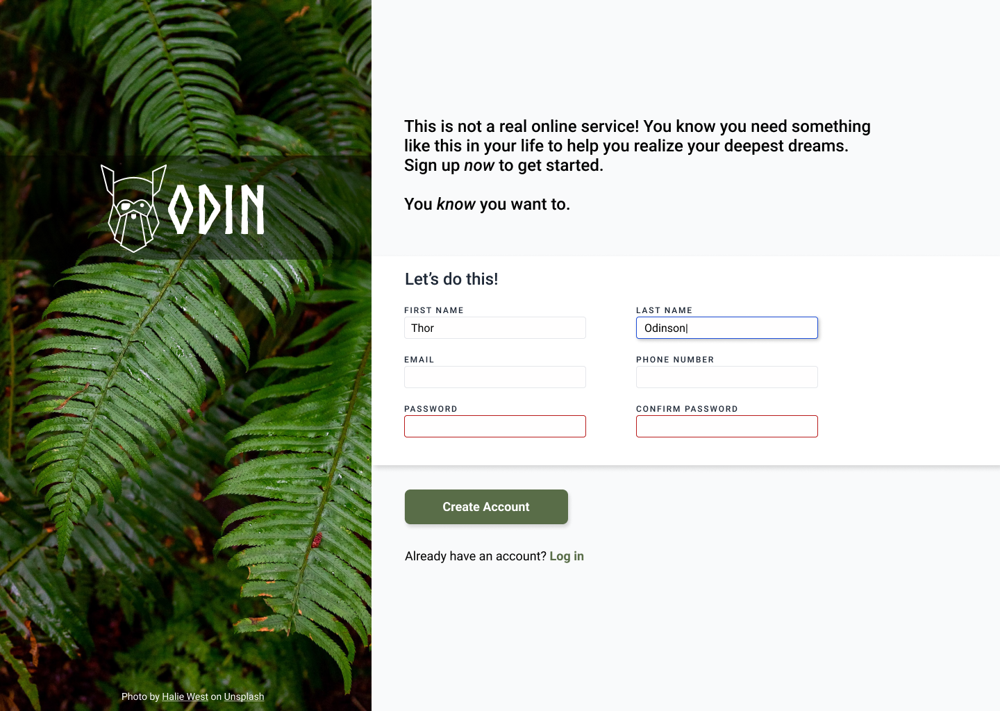

# sign-up-form

Front-end styling of an HTML form

## Project description

Styling of an HTML form using CSS, including some basic validation and custom focus style, given a design (see below)

## Project design

## Skills and technologies demonstrated

- HTML form syntax
- CSS styling for forms, usign Flexbox for layout
- Carefully reply the style of a given design
- Basic form validation

## Credits

- Photo by [Halie West](https://unsplash.com/@haliewestphoto?utm_source=unsplash&utm_medium=referral&utm_content=creditCopyText)
  on [unsplash](https://unsplash.com/photos/green-leaf-plant-in-close-up-photography-25xggax4bSA?utm_source=unsplash&utm_medium=referral&utm_content=creditCopyText)

- Norse font (brand font) by [Joël Carrouché](https://www.joelcarrouche.com/fonts/norse)
